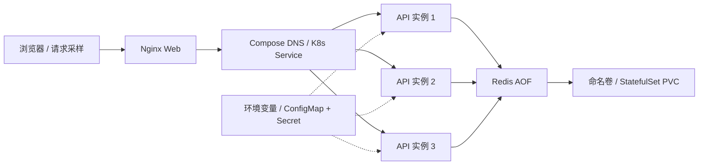

# 班级云留言板 · 云原生实验 4

同一套 **Nginx + FastAPI + Redis** 应用，在现有 Windows / Docker Desktop / WSL2 Ubuntu 24.04 上分别运行 Docker Compose 与三节点 Kind。支持发布留言、游标分页、访问计数、输入校验和实例身份展示。留言及计数由 Redis 共享，API 可以独立扩缩容。

实测数据由脚本生成，见 [结果摘要](results/summary.md)、[提交与评分清单](docs/submission-checklist.md)。课程报告为根目录 [Word 版](report.docx)和 [PDF 版](report.pdf)，可编辑正文在 `docs/report.md`。Word 的可编辑文字统一宋体，表格保持可编辑；姓名、学号按要求留空。

## 环境与实验范围

| 项目 | 本机实测 |
| --- | --- |
| 主机 | Windows 11；Ryzen 7 7840H，8 核 / 16 线程，可见物理内存约 27.69 GiB |
| Linux | WSL2 Ubuntu 24.04；Docker Desktop 托管 Linux Engine，Ubuntu 使用其集成客户端 |
| 容器工具 | Docker Desktop 4.94.0 / Engine 29.8.2；Compose 5.5.1 |
| K8s | Kind 0.33.0；Kubernetes 1.36.4；kubectl 1.36.1 |
| 应用 | Python 3.12；FastAPI 0.115.12；Redis 7.4.5；Nginx 1.28.0 |
| 资源组件 | metrics-server 0.9.0；仅实验集群使用不校验 kubelet 自签证书的参数 |
| 本地入口 | Compose `http://localhost:8090`；Kind `http://localhost:8080` |

建议给 Docker/WSL 留出至少 8 GiB 内存、4 核及 15 GiB 磁盘空间；完整复现还需要访问 GitHub、PyPI、Docker Hub 和 registry.k8s.io。脚本目前面向 **Ubuntu amd64**。Docker Desktop 应启用 Ubuntu-24.04 的 WSL Integration，Ubuntu 内 `docker info` 应成功。

主线对比 A：Compose 与 B：Kind，属于同一宿主机上的容器管理 / 编排层次对比。两者都依赖 WSL2 虚拟化基础。C：完整 Ubuntu 虚拟机中的同一工程可以作为扩展，需另外安装虚拟机软件并实测；本机未确认有 VMware，也没有实施这条路径。单主机 Kind 不证明宿主机、单控制面或单实例 Redis 的高可用。

## 架构与工程组织



API 的 CPU 上限为 0.5 核、内存上限 256 MiB；Web 0.2 核 / 128 MiB，Redis 0.5 核 / 512 MiB。K8s 的 request 是调度预算，Compose 的 memory reservation 不是同一调度机制。资源对比统计实际用量，避免将 limit 当成用量。

```
src/         API、页面、精确固定的 Python 运行依赖
docker/      API/Web/test Dockerfile、Compose、Nginx 配置
k8s/         Kind、基础资源、指标组件、Secret 生成示例
scripts/     配置、部署、入口验证、故障/伸缩/对比实验、数据汇总
tests/       真实 Redis 集成测试；采样与单位换算测试
results/     精选原始 CSV/JSON、命令输出、统计摘要和复现记录
screenshots/ 分类截图及来源索引
docs/        报告正文、架构图、验收与评分映射
report.pdf   八部分实验报告
```

所有构建基镜像都固定 SHA-256，Python 运行依赖包括传递依赖。API/Web 的 `1.0` 是从本仓库生成的本地镜像标签，修改源码后需要重新构建与导入。Redis 的多架构索引摘要固定在 Compose；Kind 使用该索引中的 amd64 manifest 摘要，实际运行内容相同。

## 从全新 clone 开始

下面命令都在 **WSL Ubuntu 的 Bash** 中执行。PowerShell 可以先进入 Ubuntu：

```powershell
wsl -d Ubuntu-24.04
```

```bash
git clone https://github.com/luoyi01/Cloud_lab4.git
cd Cloud_lab4
bash scripts/lab.sh bootstrap
export PATH="$PWD/.local/bin:$PATH"
bash scripts/lab.sh build
bash scripts/lab.sh test
bash scripts/lab.sh compose-up
python3 scripts/check.py --url http://127.0.0.1:8090 --replicas 3
bash scripts/lab.sh k8s-up
python3 scripts/check.py --url http://127.0.0.1:8080 --replicas 3
bash scripts/lab.sh metrics
kubectl --kubeconfig .local/kubeconfig top nodes
kubectl --kubeconfig .local/kubeconfig -n cloudlab top pods
bash scripts/lab.sh status
```

克隆到 Ubuntu 文件系统能避免 Windows 目录读写较慢的问题。本实验实际工程位于 `/mnt/d/XMU/大四/云计算/Cloud_lab4`，路径有中文及空格时始终加引号。

`bootstrap` 检查 Docker、curl、Python3；下载到 `.local/bin` 的 Kind 固定版本并核验摘要，缺少 kubectl 时下载固定版本并核验官方校验和。现有兼容 kubectl 会被沿用。它不会安装 VMware 或另一个 Docker Engine。

`configure` 自动生成随机 Redis 密码到被忽略的 `.env`，不会打印密码。K8s Secret 通过 `.local/redis.env` 的 env-file 生成；`k8s/secret.env.example` 仅是格式说明。密码不得提交。`.local/kubeconfig` 独立保存，不改变用户全局 Kubernetes context。

`k8s-up` 创建 1 control-plane + 2 worker，导入本地镜像并应用 YAML，等待就绪。Redis 导出时加 `--platform linux/amd64`，避免 Docker 的多架构索引包含未下载架构而使 Kind 导入失败。再次执行会重启 Redis 及 API/Web，以使 Secret/ConfigMap 更新生效；Redis 重启期间存在短暂停机窗口，数据保留。

`metrics` 下载固定的官方 amd64 镜像，逐一核验 manifest/config/layer 的 SHA-256，再导入 Kind。下载支持断点续传；慢网络首次执行可能需要数分钟。仅该本地实验使用 `--kubelet-insecure-tls`，不能照搬为生产配置。组件就绪后通常还需等待一个约 15 秒采样窗口；以 `kubectl top` 实际返回数据为准。

业务验证预期是 `checks: passed`、3 个不同实例和共享留言读取成功。测试预期全部通过。任何非 2xx、共享留言缺失、副本数量不符或 `kubectl top` 没有指标都属于未通过，先排查再采集数据。

## 页面与 API

在两个入口都可以发布留言、刷新、查看更多、更换处理实例。前端用 `textContent` 展示用户留言，避免将留言作为 HTML 执行。后端拒绝全空格、超长或错误类型；author 最多 30 字符，content 最多 300 字符。Redis Lua 将 ID、内容、索引写入放在同一次原子操作中。

| 路径 | 方法 | 用途 |
| --- | --- | --- |
| `/api/whoami` | GET | 实例、节点、版本、标题、服务端时间 |
| `/api/messages` | POST | JSON `{ "author": "同学", "content": "你好" }`，成功 201 |
| `/api/messages?limit=10&before=42` | GET | ID 倒序游标分页，limit 1–50，before 可省略 |
| `/api/visits` | POST | 原子访问计数 |
| `/health/live` | GET | 进程存活，与 Redis 就绪独立 |
| `/health/ready` | GET | Redis 可连接时 200；不可用时 503 |

所有 API 响应含实例信息，HTTP 头有 `X-Instance-ID`。API、Redis 不映射宿主机端口，入口只绑定 127.0.0.1。该留言板用于本地教学实验，未实现用户登录、限流或留言管理。

## 复现实验

先启动两条路径并确认指标可用，再按下面顺序执行。故障脚本只针对 `cloudlab` 的实验容器/Pod；不要并行运行实验。脚本使用 `.local/experiments.lock` 防止竞争，结果写入对应目录并覆盖同名上次结果；要保留另一轮结果请先复制目录。

```bash
python3 scripts/experiments.py self-heal
python3 scripts/experiments.py persistence
python3 scripts/experiments.py pdb
python3 scripts/experiments.py compose-delete
python3 scripts/experiments.py warm-start
python3 scripts/experiments.py node-failure
python3 scripts/experiments.py scale
python3 scripts/isolation.py
python3 scripts/summary.py
```

| 实验 | 方法 / 通过判据 | 证据 |
| --- | --- | --- |
| Pod 自愈 | 3 副本中默认优雅删除一个 API Pod；出现新 UID 并 Ready；持续业务请求如实统计失败 | `results/self-heal/` |
| 持久化 | 发布标记，等待 AOF 落盘，重启 Compose Redis / 重建 redis-0，读回相同内容 | `results/persistence/` |
| PDB | 降到 2 副本，预算变 0；Eviction API 被 429 拒绝，原 Pod 仍 Ready；恢复 3 | `results/pdb/` |
| Compose 删除 | 删除 API 容器，15 秒后仍只有 2；再次 `compose up` 才补回 3 | `results/compose-delete/` |
| 热启动 | Redis、镜像和平台保持运行，只停止/启动 API(3)+Web(1)，每条路径重复 5 次 | `results/comparison/warm-start.json` |
| worker 故障 | 确认 worker2 有 API，Web/Redis 在 stable worker；停止 worker2，检测 NotReady、重新调度；finally 恢复 | `results/node-failure/` |
| 伸缩 / 资源 | 各路径 1→3→5→3；100 条固定留言，4 请求线程各 5Hz，持续 65 秒；20/30/40/50/60 秒采样 | `results/scale/` |

`scale` 的固定留言使用独立 `cloudlab-benchmark` 前缀，两个数据集 SHA-256 必须相等，正常留言保留。每次仅运行正在采样路径的 API/Web，另一条路径暂停；两条 Redis 及 Kind 平台仍运行。结束后恢复正常数据前缀和三副本。请求是固定 GET `/api/messages?limit=1`，客户端使用新连接、不重试；请求超时为 2 秒，错过的采样时隙跳过，实际请求数从 CSV 统计。Nginx 对符合条件的上游失败有最多 3 次尝试，因此结果代表固定入口下的用户请求表现。

CPU 统一为 millicores，内存统一为 MiB；统计 API 合计以及 API/Web/Redis 全应用合计，取五次观测的中位数。Docker stats 与 metrics-server 的 CPU/内存统计窗口和扣除缓存方式不同，属于近似对比；五次资源观测不是五轮独立重复实验。热启动为五轮独立重复，但含各自健康检查和编排等待策略，不能解释为普遍启动性能排序。

节点故障允许出现失败，目标是记录实际边界。PDB 约束自愿 eviction，不阻止直接删 Pod 或节点突然失联。API 的 NotReady/Unreachable toleration 为 20 秒，检测本身另有延迟。Redis 单实例、Web 单副本及 local-path PVC 都在稳定 worker；故障该稳定 worker 或整个宿主机，不能保证业务可用。Redis AOF `everysec` 不保证断电时零丢失；本次持久化仅测试优雅重启。

## 配置、排查与停止

修改 Compose 标题：编辑 `.env` 的 `APP_TITLE`，运行 `compose-up`。K8s 标题位于 `k8s/base/kustomization.yaml` 的 ConfigMap literals，修改后运行 `k8s-up`。环境变量与 Nginx subPath 挂载在运行中的 Pod 不会自动刷新，需要 rollout。

```bash
docker compose --env-file .env -f docker/compose.yaml logs --tail 50 api web redis
kubectl --kubeconfig .local/kubeconfig -n cloudlab get pods -o wide
kubectl --kubeconfig .local/kubeconfig -n cloudlab describe pod <Pod名>
kubectl --kubeconfig .local/kubeconfig -n cloudlab logs deployment/api --tail 50
kubectl --kubeconfig .local/kubeconfig -n cloudlab get events --sort-by=.metadata.creationTimestamp
```

已解决 Kind 多架构镜像归档缺层、K8s Service-link 的 `REDIS_PORT` 碰撞、指标组件下载慢与 kubelet 自签证书等问题。节点失联期间的实际请求失败也保留分析。见报告第六节及 `results/issues/`。

停止 Compose 保留命名卷：`bash scripts/lab.sh compose-down`。停止 K8s 应用并保留 PVC：

```bash
kubectl --kubeconfig .local/kubeconfig -n cloudlab scale deployment/api deployment/web statefulset/redis --replicas=0
```

删除 Kind 集群用 `.local/bin/kind delete cluster --name cloudlab`，会移除集群内本地 PVC 数据，只在确定不再需要时执行。Compose 的 `down -v` 同样会删除本项目卷。本工程不提供全局 `docker prune` 或全局资源删除命令。

## 提交与加分证据

基础分逐项证据见 `docs/submission-checklist.md`：应用 25、容器化 10、K8s 15、弹性/自愈 10、对比 15、报告 10、心得 15，总计 100。加分累计最多 10 分，课程未为每项指定独立分值。

已选择可复现 Git/README、Redis StatefulSet/PVC、PDB eviction、三节点中的 API worker 故障验证，以及架构图与真实问题分析。未实现 Redis Sentinel/MySQL 自动故障转移、Ingress 或完整 CI/CD，不将其作为成果。

学号、姓名留空。课程 ZIP 使用 `学号_姓名_云原生实验.zip` 命名，填写身份信息后可执行 `python3 scripts/package.py --student-id 学号 --name 姓名`。打包按 Git 跟踪文件白名单，排除 `.git`、`.env`、kubeconfig、缓存、镜像归档、本地工作记录等。不要直接压缩整个工作目录。截止时间以课程群通知为准。

全新克隆的独立 Compose/Kind 复现记录在 `results/reproduction/`；使用新项目/集群与 8091/8081 端口。主线用默认 `cloudlab` 名称与 8090/8080。额外实例可设置 `LAB_PROJECT`、`LAB_CLUSTER`、`LAB_COMPOSE_PORT`、`LAB_KIND_PORT`；故障实验驱动固定针对主线，额外实例仅供部署验证。

报告已经包含在提交材料中。需要根据重新测量的数据再生成时，在 Git 工作目录中使用独立 Python 环境：

```bash
python3 -m venv .local/report-venv
.local/report-venv/bin/pip install -r docs/requirements.txt
.local/report-venv/bin/python scripts/build_report.py --font /mnt/c/Windows/Fonts/msyh.ttc
.local/report-venv/bin/python scripts/build_word_report.py --font /mnt/c/Windows/Fonts/simsun.ttc
```

Ubuntu 若没有 `venv` 模块，先通过系统包安装 `python3-venv`；其他 Linux 主机使用本机支持中文的 TTF/TTC 字体路径，Word 图表需提供宋体字体文件。PDF 生成器核验完整伸缩、持久化、PDB 和测试证据，从本轮 JSON 更新表格及结论。`docs/report.md` 可单独编辑，重新运行 PDF 生成器会覆盖它；Word 生成器读取该正文并生成统一宋体的 DOCX，另生成宋体架构图和资源图。提交前检查报告，提交修改后再运行打包脚本，使 ZIP 记录的提交与内容一致。Word 版已经通过本机 Word 排版和全部 15 页预览检查，记录在 `results/word-report-verification.json`。

## 参考资料

- [Docker Desktop WSL 2 backend](https://docs.docker.com/desktop/features/wsl/)
- [Compose up / scale](https://docs.docker.com/reference/cli/docker/compose/up/)
- [Kind 配置与端口映射](https://kind.sigs.k8s.io/docs/user/configuration/)
- [Kind v0.33.0 节点镜像](https://github.com/kubernetes-sigs/kind/releases/tag/v0.33.0)
- [Kubernetes 探针](https://kubernetes.io/docs/tasks/configure-pod-container/configure-liveness-readiness-startup-probes/)
- [StatefulSet](https://kubernetes.io/docs/concepts/workloads/controllers/statefulset/)、[PDB](https://kubernetes.io/docs/tasks/run-application/configure-pdb/)
- [metrics-server](https://github.com/kubernetes-sigs/metrics-server)
- [Redis 持久化](https://redis.io/docs/latest/operate/oss_and_stack/management/persistence/)
- [Nginx upstream / resolve](https://nginx.org/en/docs/http/ngx_http_upstream_module.html)
