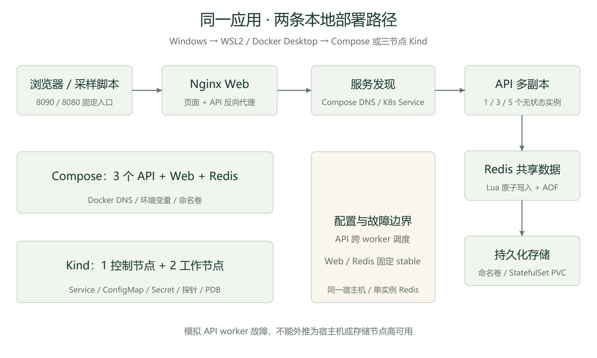
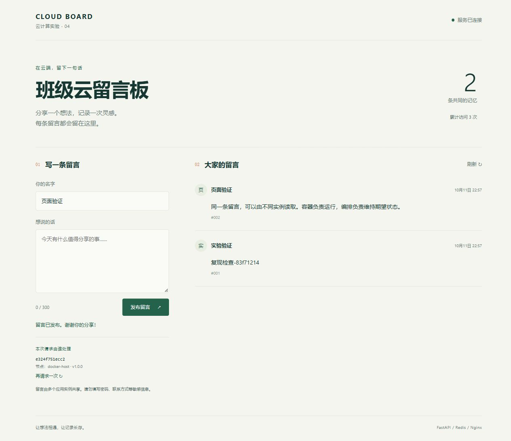
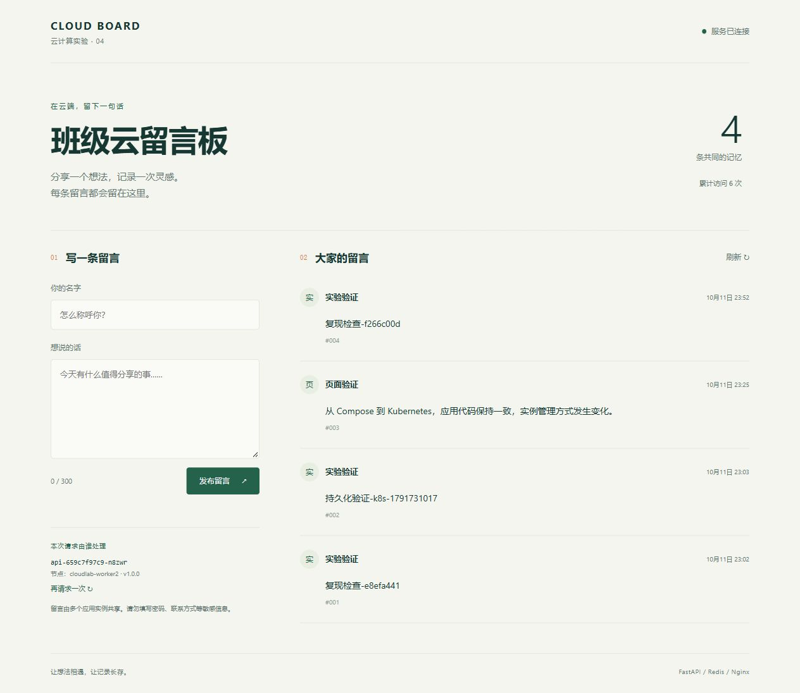
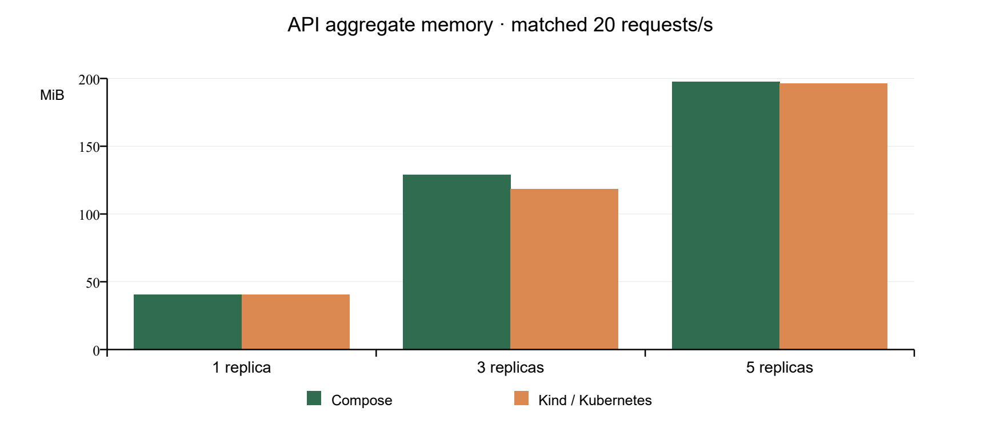
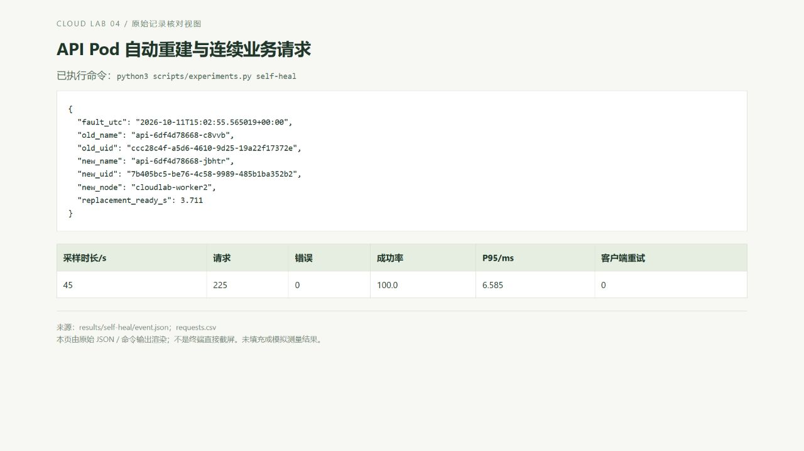
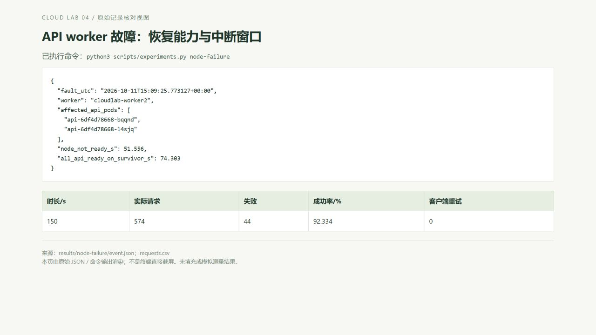

# 班级云留言板：云计算实验 4

学号：________________    姓名：________________

实验平台：Windows 11 / Docker Desktop / WSL2 Ubuntu 24.04

交付版本：v1.0.0；业务部署基线：5cd20a7aed74。最终源码与报告以 Git 仓库的发布版本及压缩包 SUBMISSION.txt 为准。

仓库：https://github.com/luoyi01/Cloud_lab4

本报告依据实际运行数据编写。A 为 Docker Compose，B 为三节点 Kind；完整虚拟机属于尚未实施的可选扩展。



## 一、实验概述

实验目标是将一个有真实业务的多单元应用容器化，在本地 Kubernetes 上编排运行，再以相同应用比较容器运行与编排机制。应用选用班级留言板：Nginx 提供页面与固定入口，FastAPI 负责留言和访问计数，Redis 保存共享数据。三个运行单元职责独立，API 默认三个副本，并通过实例身份接口证明请求由不同实例处理。

必做验证包括 Dockerfile 构建、端口与环境配置、持久化卷、Deployment/Service/ConfigMap/Secret、Pod 自动重建、扩缩容及资源变化。进阶部分选用 StatefulSet/PVC、PDB 和两个 worker 的节点故障测试。实验保留连续请求 CSV、旧新 Pod UID、事件与指标原始数据，用于核对报告结论。

表 1  百分制评分与证据映射（总计 100 分）

| 课程评分项 | 分值 | 交付证据 |
| --- | --- | --- |
| 应用设计与实现 | 25 | src/、20 项测试、共享数据与实例验证 |
| 容器化 | 10 | docker/、镜像构建、Compose 运行与卷 |
| K8s 部署与编排 | 15 | k8s/、资源 Ready、配置与 Secret 注入 |
| 弹性伸缩与自愈 | 10 | 1→3→5→3 指标、Pod UID 与连续请求 |
| 消融对比实验 | 15 | 五次热启动、固定数据/负载资源、删除对照 |
| 报告结构与规范 | 10 | 八部分正文、图表、分类截图、参考资料 |
| 心得与技能收获 | 15 | 第七节结合真实问题和边界分析 |

提交包含 src/、docker/、k8s/、分类 screenshots/、本报告与 README；scripts/、tests/、results/、docs/提供复现和核验。压缩包使用学号_姓名_云原生实验.zip；本次按要求先留空身份信息，需提交时补充或重命名。截止时间以课程群通知为准。

## 二、环境与工具

表 2  实测环境

| 层次 | 实测环境与版本 |
| --- | --- |
| 宿主机 | Windows 11；Ryzen 7 7840H，8 核 / 16 线程；可见内存约 27.69 GiB |
| 虚拟化基础 | WSL2 Ubuntu 24.04；Docker Desktop 托管 Linux Engine，Ubuntu 使用 WSL 集成 |
| 容器工具 | Docker Desktop 4.94.0；Engine 29.8.2；Compose 5.5.1 |
| 编排工具 | Kind 0.33.0；Kubernetes 1.36.4；kubectl 1.36.1；1 控制节点 + 2 worker |
| 业务组件 | Python 3.12 / FastAPI 0.115.12 / Redis 7.4.5 / Nginx 1.28.0 |
| 指标组件 | metrics-server 0.9.0，官方镜像固定摘要；本地 kubelet 自签证书采用实验参数 |

A 使用现有 Docker Desktop 上的 Compose；B 使用同一 Engine 上的 Kind。两条路径均通过 WSL2 支撑，不是原生 Linux 与 Windows 的性能对照。C 可在额外安装的完整 Ubuntu 虚拟机上运行同一仓库，以比较独立 guest OS 的资源、启动与隔离，但本次没有安装或测量 C。虚拟机方案仅作为可行性分析，不能用估计数字替代实测。

API 上限固定为 500m CPU / 256Mi，Web 为 200m / 128Mi，Redis 为 500m / 512Mi。K8s request 分别是 API 100m/128Mi、Web 50m/64Mi、Redis 100m/128Mi。Compose 使用相同 CPU/内存上限及 memory reservation，但没有 K8s 调度器，二者语义不能简单视为相同。

## 三、应用设计与实现

留言记录含 ID、作者、内容和 UTC 时间。作者最多 30 字符、内容最多 300 字符；拒绝空白、超长和错误类型。Redis Lua 将自增 ID、Hash 内容与 Sorted Set 索引写入合并为原子操作，避免并发写入时 ID 重复或索引不一致。访问计数使用 Redis INCR。所有副本只保存连接与配置，不保存业务数据。

查询采用 ID 倒序游标分页，而不是会被新留言挤动的页码偏移。返回 next_cursor，下一页使用 before 游标。前端以 textContent 显示留言，避免将用户输入解释为 HTML。页面有发布反馈、字符计数、空状态、刷新与继续加载，并展示本次处理的实例和节点。

表 3  接口契约

| 接口 | 功能与验证 |
| --- | --- |
| GET /api/whoami | 实例、节点、版本、标题与时间；Compose 为容器 hostname，K8s 由 Downward API 注入 |
| POST /api/messages | 输入校验；成功 201；失败 422；原子写入 |
| GET /api/messages | limit 1–50；before 游标；共享数据读取 |
| POST /api/visits | 多副本共享的原子计数 |
| GET /health/live | 进程存活；不会因为 Redis 暂时失败而直接重启 API |
| GET /health/ready | 检查 Redis 连接；不可用时 503 并退出流量分发 |

测试使用真实 Redis，而不是伪造存储：校验正常留言、错误输入、游标在插入后不重复、40 次并发创建 ID、40 次并发计数、进程重建后数据、健康探针以及存储失败时不泄漏内部信息。另以本地 HTTP 服务验证 503 逐条记入采样结果且没有隐藏重试，并测试 CPU/内存单位换算。另验证实验中断后的服务恢复。全套 20 项通过，证据见 results/tests/green.log；初始失败记录见 red.log。



## 四、部署过程记录

### 4.1 Compose 容器化

```bash
bash scripts/lab.sh bootstrap
export PATH="$PWD/.local/bin:$PATH"
bash scripts/lab.sh build
bash scripts/lab.sh test
bash scripts/lab.sh compose-up
python3 scripts/check.py --url http://127.0.0.1:8090
```

API 与 Web 分别有 Dockerfile。Python 运行依赖连同传递依赖精确固定；Python、Nginx、Redis 基镜像固定摘要。API 使用非 root 用户及只读根文件系统。Compose 创建内部网络，以 redis/API 服务名发现组件，只将 Web 的 80 端口映射到 127.0.0.1:8090；API 与 Redis 没有宿主机端口。Redis 用随机密码、命名卷和 AOF everysec。

执行 bootstrap、build、test、compose-up 后，真实入口验证脚本连续采样身份，确认三个实例均可读到同一条新留言；再验证访问计数递增。restart: unless-stopped 可以作用于容器进程退出，但不会把已删除容器重新创建。该差异在第五节的删除对照中实际验证。

### 4.2 Kind 编排与配置

```bash
bash scripts/lab.sh k8s-up
bash scripts/lab.sh metrics
kubectl --kubeconfig .local/kubeconfig -n cloudlab get pods -o wide
```

Kind 配置一控制节点与两个 worker。控制节点 30180 的 NodePort 映射到宿主机 127.0.0.1:8080，提供稳定外部入口。API Deployment 默认三个副本，Service 维持固定名字和地址；ConfigMap 配置标题、版本、Redis 主机与数据前缀；Secret 通过本地 env-file 生成密码。Pod 名及 Node 名由 Downward API 注入。

API 使用 startup、readiness、liveness 探针；readiness 依赖 Redis，liveness 只判断进程。终止前延迟五秒并预留 30 秒宽限，让 EndpointSlice 移除和服务端终止有缓冲。副本用拓扑分散约束部署到两个 worker，ScheduleAnyway 允许单 worker 故障后继续调度。未用 port-forward 做可用性证明，因为它绑定具体 Pod，会受 Pod 删除影响。

Redis 使用 StatefulSet，固定 redis-0 身份，headless Service 加客户端 Service，以及 1Gi PVC。Web 与 Redis 放在 stable worker，另一个 worker 只承载本轮故障测试的 API。local-path PV 与该 worker 关联，所以该设计只能观察 API 节点故障，不能证明 Redis 自动故障转移。



### 4.3 弹性伸缩与自愈操作

```bash
python3 scripts/experiments.py self-heal
python3 scripts/experiments.py scale
python3 scripts/summary.py
```

API 按 1→3→5→3 调整，等待目标 Ready 数量及业务入口可达后采样。每一步的 Pod 指标、实例列表和五次资源观测保存在 results/scale/。自愈操作在持续业务请求期间删除一个 Pod，以新 UID 确认重建；本轮替代 Pod 3.711 秒就绪，225 次请求中 0 次错误。具体数据与解释见第五节。

### 4.4 加分项完成状态

表 4  加分项映射（累计最多 10 分，未自拟单项分值）

| 文档加分项 | 本次状态与边界 |
| --- | --- |
| StatefulSet / PDB / Ingress 等 | 已做 StatefulSet/PVC 和 PDB eviction；未做 Ingress |
| 多节点节点级高可用验证 | 已停止一个 API worker，记录重新调度与 44 次失败；单主机、单控制面不保证平台 HA |
| 可复现 Git / README | 仓库固定版本、自动生成配置、独立 clone 部署验证、打包脚本 |
| 架构图与深入问题分析 | 图 1 及第六、七节，结合失败日志和实测数据 |
| Redis Sentinel / MySQL 故障转移 | 未实现；单实例持久化不等于该项 |
| 完整 CI/CD 自动部署 | 未实现；没有用单独测试脚本冒充完整流水线 |

## 五、消融对比实验

### 5.1 实验控制与统计口径

同一源码与镜像、相同 CPU/内存上限、相同端点与请求节奏。资源实验使用单独 cloudlab-benchmark 数据前缀的 100 条固定留言，两个数据集 SHA-256 必须一致；正常留言不删除。每轮只运行正在采样路径的 API/Web，另一条路径暂停；Kind、两条 Redis 仍存在。客户端四线程各每 0.2 秒发一个业务 GET，共目标 20 请求/秒，持续 65 秒，不重试，并使用新连接。超时或延迟使实际请求数偏离目标，按 CSV 实际统计。

在 20、30、40、50、60 秒采集五次用量，汇总中位数。Docker 用 docker stats，K8s 用 metrics.k8s.io/v1beta1；CPU 换算为 m，内存换算为 MiB。统计 API 合计与 API/Web/Redis 应用合计，不含平台及其他数据存储的开销。不同指标系统的 CPU 时间窗口和内存缓存口径并非完全相同，数值用于近似描述，不能严格证明某平台更省资源。五次采样是同一轮中的观测，不是五轮独立重复。

### 5.2 五次热启动

保留 Redis、镜像和平台，只重新启动三个 API 与一个 Web。计时从启动命令开始到全部期望服务就绪及公开业务端点返回 200。排除下载、构建、Docker Desktop/WSL2 启动及 Kind 建群；每条路径独立重复五次。这是在既定健康检查配置下的热启动对照。

表 5  无状态服务热启动

| 路径 | 次数 | 均值 / s | 标准差 / s | 最小 / s | 最大 / s |
| --- | --- | --- | --- | --- | --- |
| compose | 5 | 12.569 | 0.069 | 12.492 | 12.674 |
| k8s | 5 | 3.462 | 0.11 | 3.276 | 3.535 |

本轮热启动均值为 Compose 12.569 秒、Kind 3.462 秒。差异可能受 readiness 的两秒周期、Compose 五秒健康检查及现有调度状态影响。该结果不能推导为普遍的启动性能排序，也不能当成完整虚拟机与 WSL2 启动成本的测量。

### 5.3 1→3→5→3 扩缩容及资源

表 6  伸缩就绪时间与 API 用量（资源为五次观测中位数）

| 路径 / 步骤 | 副本 | Ready / s | API CPU / m | API 内存 / MiB | P95 / ms |
| --- | --- | --- | --- | --- | --- |
| compose / 1 | 1 | 7.734 | 64.4 | 40.56 | 63.055 |
| compose / 2 | 3 | 7.282 | 194.0 | 129.05 | 8.115 |
| compose / 3 | 5 | 7.404 | 388.8 | 197.49 | 6.147 |
| compose / 4 | 3 | 2.474 | 261.6 | 119.19 | 7.22 |
| k8s / 1 | 1 | 3.316 | 63.991 | 40.613 | 12.652 |
| k8s / 2 | 3 | 3.072 | 66.664 | 118.355 | 9.699 |
| k8s / 3 | 5 | 3.12 | 68.175 | 196.262 | 8.798 |
| k8s / 4 | 3 | 0.717 | 61.419 | 119.555 | 9.762 |

表 7  全应用资源与固定负载请求结果

| 路径 / 步骤 | 全应用 CPU / m | 全应用内存 / MiB | 请求数 | 错误数 |
| --- | --- | --- | --- | --- |
| compose / 1 | 81.9 | 59.742 | 1300 | 0 |
| compose / 2 | 212.1 | 148.692 | 1300 | 0 |
| compose / 3 | 406.6 | 217.818 | 1300 | 0 |
| compose / 4 | 309.7 | 140.156 | 1300 | 0 |
| k8s / 1 | 93.762 | 60.438 | 1300 | 0 |
| k8s / 2 | 98.923 | 139.121 | 1300 | 0 |
| k8s / 3 | 98.914 | 216.551 | 1300 | 0 |
| k8s / 4 | 91.392 | 139.516 | 1300 | 0 |



副本增加会重复 Python 进程和连接池的基础内存；在固定总请求量下，增加副本不会使总业务量同步增加。因此低负载时副本主要提高容错余量，不必然降低延迟或 CPU 合计。本实验没有施加饱和压力，也没有测吞吐上限，不能据此声称五副本带来线性性能提升。

### 5.4 自愈、容器删除和持久化

三副本中默认优雅删除一个 API Pod，旧 UID ccc28c4f-a5d6-4610-9d25-19a22f17372e，替代 UID 7b405bc5-be76-4c58-9989-485b1ba352b2。新 Pod 在 3.711 秒后 Ready。45 秒内共 225 次连续业务请求，错误 0 次；这只能证明本次采样窗口内成功，并不是所有故障情形下零中断的保证。

Compose 删除一个 API 容器后，15 秒后仍有两副本。Compose 没有常驻期望状态控制器，需要再次执行 compose up 才补回。Docker restart policy 与 Kubernetes Deployment 的重建职责不同：前者针对现存容器，后者不断维持期望的 Pod 副本数。



两条路径分别写入持久化标记，等待 AOF everysec，优雅重启 Redis / 重建 redis-0 后读取结果完全一致。StatefulSet 维持身份和 PVC 绑定，数据卷提供存储。这个测试不包含断电、PV 节点故障或 Redis 主从故障转移。

### 5.5 PDB 与 API worker 故障

API 降为两副本，PDB minAvailable=2 的 disruptionsAllowed 变为零。Eviction API 返回 TooManyRequests/429，原 Pod UID 与 Ready 状态保持不变，随后恢复三副本。这验证自愿驱逐预算；直接 delete pod、Deployment 缩容、节点突然失联并不由 PDB 阻止。

停止 cloudlab-worker2 前有 2 个 API 位于该节点，Web 与 Redis 在存活 stable worker。51.556 秒检测到 Node 非 Ready，74.303 秒后全部 API 在存活 worker 就绪。150 秒采样共 574 请求、44 错误，成功率 92.334%。故障节点在 finally 中恢复，所有节点重新 Ready。

失败出现在失联检测、EndpointSlice 更新及重新调度窗口。Nginx 对符合条件的请求最多尝试三次上游，但在死节点后端仍存在时仍可能失败。API 的 20 秒 toleration 只缩短失联确认后的驱逐等待，不消除节点检测延迟。结果展示了恢复能力，也展示了本地 HA 的局限。



表 8  同应用的编排机制对比

| 比较维度 | Compose | Kind / Kubernetes |
| --- | --- | --- |
| 副本管理 | up --scale，一次性执行 | Deployment 持续维持期望副本 |
| 删除后恢复 | 被删除容器不会自动创建 | 新 UID Pod 自动调度与 Ready |
| 配置 | 环境变量、挂载文件 | ConfigMap/Secret，变更后 rollout |
| 服务发现 | Docker DNS + Nginx 动态 resolve | Service/EndpointSlice，固定入口 |
| 持久化 | Redis 命名卷 | StatefulSet + PVC，仍为 local-path |
| 复杂度与隔离 | 配置较少，便于本地多单元启动 | 控制面、调度、探针、拓扑、预算；同主机节点仍共享物理故障域 |

### 5.6 内核与命名空间隔离观察

表 9  实际命名空间标识（python3 scripts/isolation.py）

| 观察项 | WSL Ubuntu | Compose API | Kind API |
| --- | --- | --- | --- |
| pid | pid:[4026532390] | pid:[4026533559] | pid:[4026533879] |
| mnt | mnt:[4026532388] | mnt:[4026533556] | mnt:[4026533878] |
| net | net:[4026531833] | net:[4026533561] | net:[4026533799] |

三处观测到相同内核 6.18.40.1-microsoft-standard-WSL2，而 PID、mount、network namespace 标识不同。Ubuntu 读取当前进程 /proc/self/ns，容器读取 /proc/1/ns；容器内 PID 1 的 comm 为 uvicorn，根目录包含镜像中的 app 文件夹，网络接口为各自的 lo/eth0。原始目录及接口列表在 results/comparison/isolation.json。两种路径在共享内核上提供容器视图；增加 Kind 引入了编排和节点容器，没有创建独立 guest 内核。该观察不代表安全攻防测试。完整虚拟机的独立内核、冷启动与资源开销仍需另行实测。

## 六、问题与分析

### 6.1 多架构镜像导入缺层

现象：Kind 导入 Redis 时 ctr 报 content digest not found。Docker Desktop 保存的是多架构索引，而本机只下载 amd64 层；导入工具遍历全部平台时找不到其他平台内容。处理：docker image save --platform linux/amd64 后导入归档，并将 amd64 manifest digest 绑定为镜像引用。验证：redis-0 Ready，同一版本读写与持久化通过。只改架构导出，不替换为来源不明镜像。

### 6.2 Service-link 环境变量冲突

现象：Compose 正常，Kind API CrashLoopBackOff；日志显示 int(REDIS_PORT) 收到 tcp://ServiceIP:6379。原因是 Kubernetes 默认 Service-link 环境变量与应用的 REDIS_PORT 名字重合。处理：API Pod enableServiceLinks=false，保留 DNS 和 ConfigMap 的显式配置。验证：API 全部 Ready，三个身份及共享留言测试通过；原始失败日志保存在 results/issues/service-links-red.log。

### 6.3 指标下载与 kubelet 证书

官方指标镜像下载较慢且有暂时 TLS 连接错误。处理：WSL curl 从官方 registry 下载固定 OCI manifest 与各层，逐层验证 SHA-256，支持断点续传及排他锁，不修改用户代理。镜像就绪后，Kind 的 kubelet 自签证书缺少可验证的 IP SAN，metrics-server 抓取失败。仅对本实验集群添加 kubelet-insecure-tls，并保留失败日志；生产应正确配置受信任的 kubelet 证书。kubectl top 实际有数据后才进行资源采样。

### 6.4 节点恢复与可用性不是同一指标

Pod 优雅删除窗口出现 0 次错误，突然停止 worker 出现 44 次错误。前者能提前移除就绪端点，后者需要控制面判断失联。两种故障必须独立报告，不能用一次成功自愈宣称全局高可用。进一步改进需考虑外部冗余入口、多控制面、跨物理主机 worker、真正的 Redis 故障转移与更严格的负载测试。

## 七、心得体会与技能收获

这次实验让我更清楚地理解了虚拟化、容器化和编排之间的层次。WSL2 提供 Linux 虚拟化基础，Docker 解决应用封装与运行，Kubernetes 则提供期望状态、调度和流量管理。它们解决的问题不同，所以比较时必须先划定边界。把本机没有安装的虚拟机软件列为实测环境，会让后续资源和隔离结论失去依据；方案应从现有条件出发，扩展路径则明确标为待实施。

我最有收获的是看到同一应用在两种环境下表现不同：Compose 能一次性启动三副本，却不会补回已删除容器；Deployment 则会创建新的 Pod。这个现象比单纯记住命令更能说明控制器的作用。另一个例子是 REDIS_PORT 的环境变量冲突，它提醒我部署失败不一定是业务逻辑错误，也可能来自运行平台的隐式配置。排查时应先读取原始日志，再验证假设。

我也认识到，多副本与数据一致性不能依赖每个进程自己的内存。留言 ID 和访问计数都需要共享存储的原子操作；分页还要考虑新留言插入时是否重复。另一方面，把 Redis 放入 StatefulSet 并挂载 PVC，只能证明身份和数据的持久化管理，并没有自动得到主从切换或跨节点存储高可用。

节点故障时的 44 次失败让我意识到，恢复耗时和用户可用性要分别衡量。保留失败数据比只展示恢复后的 Ready 更有价值。资源测量同样需要谨慎：固定总负载下，更多副本会增加基础内存，却不能凭低负载延迟推断性能上限；Docker 和 K8s 的指标窗口也有差异。之后我希望在跨物理主机环境中加入冗余入口和 Redis Sentinel，再用明确的业务成功判据测量不同故障的恢复时间。

最后，可复现性本身是实验的一部分。依赖固定、镜像摘要、独立 kubeconfig、随机凭证生成、原始 CSV 和全新 clone 验证，可以让其他人核对过程。仓库应只包含源代码与必要证据，把密码、缓存和本地工作记录排除，避免材料杂乱或暴露不应提交的信息。

## 八、参考文献与资料

[1] 课程文档：作业4（改）.docx：技术要求、六提交要求、七评分标准及加分项

[2] Docker WSL 2 backend：https://docs.docker.com/desktop/features/wsl/

[3] Docker Compose up：https://docs.docker.com/reference/cli/docker/compose/up/

[4] Kind configuration：https://kind.sigs.k8s.io/docs/user/configuration/

[5] Kind v0.33.0：https://github.com/kubernetes-sigs/kind/releases/tag/v0.33.0

[6] Kubernetes probes：https://kubernetes.io/docs/tasks/configure-pod-container/configure-liveness-readiness-startup-probes/

[7] StatefulSet：https://kubernetes.io/docs/concepts/workloads/controllers/statefulset/

[8] PDB：https://kubernetes.io/docs/tasks/run-application/configure-pdb/

[9] metrics-server：https://github.com/kubernetes-sigs/metrics-server

[10] Redis persistence：https://redis.io/docs/latest/operate/oss_and_stack/management/persistence/

[11] Nginx upstream：https://nginx.org/en/docs/http/ngx_http_upstream_module.html

证据导航：results/summary.md 为数据摘要；deployment/ 为节点和资源命令输出；self-heal/、scale/、persistence/、pdb/、node-failure/、comparison/ 为对应实验原始数据；reproduction/ 为全新 clone 验证；screenshots/README.md 标注截图来源。
